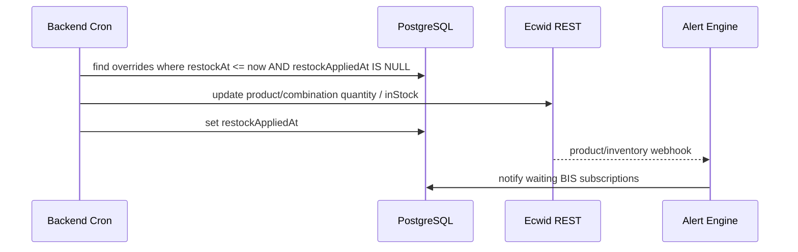

# Smart Alerts — Wix → Ecwid (Lightspeed eCom E-Series) Replication Plan

> Absolute blueprint for porting **us-smart-alerts** from Wix CLI / Astro to Ecwid.
> Source of truth: this repo’s `src/` tree (extensions, `src/lib/smart-alerts/*`, APIs, collections, events).

---

## 1. Executive Summary & Architecture Overview

### 1.1 What this app does

Smart Alerts is a **merchant + shopper notification product**:

| Audience | Capability |
|---|---|
| Shoppers | Back-in-stock waitlist, price-drop watch, optional WhatsApp queue |
| Merchants | Seller OOS / low-stock emails, inventory tracker + scheduled restock mutations, email branding, storefront urgency UI |
| Storefront | PDP “Notify Me” / “Watch Price” CTAs + modal; low-stock badge; restock countdown timer |

Business logic lives in `src/lib/smart-alerts/engine.ts` and helpers. Platform I/O (Wix Data, Stores Catalog/Inventory SDKs, dashboard JWT, site plugins) must be replaced for Ecwid; **alert evaluation, templates, quotas, and subscription state machine stay identical**.

### 1.2 Wix architecture (current)

```
┌─────────────────────────────────────────────────────────────────┐
│ Wix Site / Dashboard                                            │
│  Dashboard `my-page` (@wix/design-system) → /api/admin (JWT)    │
│  Site plugins: smart-alerts-pdp, smart-alerts-buttons           │
│  Embedded script: smart-alerts-corner (legacy)                  │
└────────────┬───────────────────────────────┬────────────────────┘
             │                               │
             ▼                               ▼
┌────────────────────────┐    ┌──────────────────────────────────┐
│ Astro API routes       │    │ Backend events (Stores SDK)      │
│ /api/admin             │    │ inventory-stock-updated          │
│ /api/subscribe         │    │ inventory-item-updated           │
│ /api/public-config     │    │ inventory-variants-changed-v1    │
│ /api/product-context   │    │ product-updated/changed/deleted  │
│ /api/restock-tick      │    │ app-instance-installed           │
└────────────┬───────────┘    └──────────────┬───────────────────┘
             │                               │
             ▼                               ▼
┌─────────────────────────────────────────────────────────────────┐
│ src/lib/smart-alerts/*  (engine, config, products, email, …)    │
│ Wix Data collections (privileged) + auth.elevate                │
│ Secrets Manager via getSecret(); DEV env fallback               │
└─────────────────────────────────────────────────────────────────┘
```

Key traits:

- **Wix CLI / Astro app** — not classic Velo (`$w` / `.jsw` absent).
- **Privileged backend** uses `auth.elevate`, not `suppressAuth`.
- **Admin** requires dashboard session (`requireDashboardAuth` — USER/APP JWT).
- **Storefront** is public CORS → `/api/subscribe`, `/api/public-config`, `/api/product-context`, `/api/restock-tick`.

### 1.3 Ecwid architecture (target)

```
┌─────────────────────────────────────────────────────────────────┐
│ Ecwid Control Panel (iframe)     │  Ecwid Storefront            │
│ EcwidApp.init() admin SPA        │  Custom JS / HTML widget     │
│ mirrors my-page tabs             │  inject urgency + CTAs       │
└──────────────┬───────────────────┴──────────────┬───────────────┘
               │ OAuth session                    │ public CORS
               ▼                                  ▼
┌─────────────────────────────────────────────────────────────────┐
│ Independent Node backend (Express / Next.js API)                │
│  /api/admin/*  /api/subscribe  /api/public-config               │
│  /api/product-context  /api/restock-tick  /webhooks/ecwid       │
│  Cron worker: due restocks                                      │
└──────────────┬───────────────────────────────┬──────────────────┘
               │                               │
               ▼                               ▼
┌──────────────────────────┐    ┌─────────────────────────────────┐
│ PostgreSQL (Prisma)      │    │ Ecwid REST API v3               │
│ config, subscriptions,   │    │ Products, inventory, webhooks   │
│ overrides, templates,    │    │ OAuth access tokens per storeId │
│ alerts, wa queue, events │    │                                 │
└──────────────────────────┘    └─────────────────────────────────┘
│ Email: SendGrid/SES/…    │    │ WhatsApp: wa.me / Business API  │
└──────────────────────────┘    └─────────────────────────────────┘
```

### 1.4 Service / extension mapping

| Wix (this app) | Role | Ecwid equivalent |
|---|---|---|
| Dashboard page `my-page` | Merchant hub: Dashboard / Automation / Email & Branding / Storefront Widget / Logs & Quota | Ecwid iframe admin app (`EcwidApp.init()`) |
| Data collection `config` | Singleton site config (`modules`, `appearance`, `brand`, quotas, trigger rules, WhatsApp setup, sync settings) | External DB row keyed by `storeId` |
| Data collection `subscriptions` | Back-in-stock / price-drop waitlists (`waiting` / `notified` / `cancelled`) | `subscriptions` table: `storeId` + `ecwidProductId` (+ combination) |
| Data collection `productOverrides` | Per-product tracking, restock dates, low-stock overrides, price/stock baselines | `product_overrides` + optional catalog cache tables |
| Data collection `templates` | Email HTML templates per alert type | `templates` table / object storage |
| Data collection `alerts` | Sent-alert audit log + quota counting | `alerts` table |
| Data collection `whatsappQueue` | Manual WhatsApp `wa.me` queue | `whatsapp_queue` table |
| Data collection `processedEvents` | Idempotency for webhook fan-out | `processed_events` unique `(storeId, eventKey)` |
| Site plugin `smart-alerts-pdp` | PDP urgency: low-stock badge + restock countdown | Storefront JS injection / custom HTML / PDP hooks |
| Site plugin `smart-alerts-buttons` | PDP “Notify Me” / “Watch Price” + modal | Injected storefront widget + modal |
| Embedded script `smart-alerts-corner` | Legacy corner “My alerts” widget | **Intentional drop** on Ecwid (document as non-goal unless merchants demand parity) |
| APIs: `/api/admin`, `/api/subscribe`, `/api/public-config`, `/api/product-context`, `/api/restock-tick` | Admin CRUD + public subscribe + PDP context + restock tick | Same route shapes on Node backend + Ecwid REST v3 |
| Events: inventory + product + `app-instance-installed` | Stock/price → notify; cleanup; install bootstrap | Ecwid webhooks: `product.updated`, `product.deleted`, inventory-related payloads, `application.uninstalled` |
| Wix Catalog `productId` / `variantId` | Catalog sync & snapshots | Ecwid `productId` + `combinationId` / SKU → store as `ecwidProductId` / `ecwidCombinationId` |
| Email (`email.ts`, `wix-email.ts`) + WhatsApp | Transactional channels | SendGrid/SES/etc. + `wa.me` / WhatsApp Business API |
| Secrets via `getSecret()` | App secrets | Backend `.env` + encrypted per-store tokens in DB |

### 1.5 Module & alert taxonomy (preserve exactly)

From `src/lib/smart-alerts/constants.ts`:

| `ModuleKey` | Default ON | Purpose |
|---|---|---|
| `backInStock` | ✓ | Shopper BIS email |
| `priceDrop` | ✓ | Shopper price-drop email |
| `manualWhatsapp` | ✓ | Queue `wa.me` links |
| `sellerOutOfStock` | ✓ | Seller OOS email |
| `sellerLowStock` | ✓ | Seller low-stock email |
| `stockCounter` | ✓ | PDP quantity urgency |
| `restockCountdown` | ✓ | PDP timer from `restockAt` |

| `AlertType` | Channel |
|---|---|
| `back_in_stock` | Email → shopper |
| `price_drop` | Email → shopper |
| `seller_oos` | Email → `sellerEmail` |
| `seller_low_stock` | Email → `sellerEmail` |
| `whatsapp` | Manual queue |

Subscription states: `waiting` → `notified` | `cancelled`.

---

## 2. Admin Controls & Dashboard (Merchant Management)

### 2.1 UI shell — Ecwid iframe admin

Mirror `src/extensions/dashboard/pages/my-page/my-page.tsx`:

**Primary tabs** (`PrimaryTab`):

1. `dashboard` — Dashboard  
2. `automation` — Automation  
3. `email` — Email & Branding  
4. `storefront` — Storefront Widget  
5. `logs` — Logs & Quota  

**Automation sub-nav** (`AutomationSub`): `rules` | `lists` | `inventory` | `whatsapp` | `settings`.

#### Bootstrap (Ecwid Native Application JS SDK)

```html
<!DOCTYPE html>
<html>
<head>
  <script src="https://djqizrxa6pr0.cloudfront.net/ecwid-sdk/js/1.3.0/ecwid-app.js"></script>
  <link rel="stylesheet" href="https://djqizrxa6pr0.cloudfront.net/ecwid-sdk/css/1.3.8/ecwid-app.css">
</head>
<body>
  <div id="root"></div>
  <script>
    EcwidApp.init({
      app_id: 'smart-alerts', // your Ecwid app namespace
      autoloadedflag: true,
      autoheight: true
    });
    const storeId = EcwidApp.getPayload()?.store_id;
    const accessToken = EcwidApp.getPayload()?.access_token;
    // Pass storeId + short-lived session to your SPA; never put client secret in iframe.
  </script>
</body>
</html>
```

Admin SPA calls **your** backend `/api/admin` with:

- `X-Store-Id: {storeId}`
- `Authorization: Bearer {adminSessionJwt}` (issued by your OAuth callback after Ecwid install)

Do **not** expose the Ecwid permanent access token to the browser long-term; exchange OAuth code server-side and store encrypted tokens in DB.

### 2.2 Tab hierarchy — feature parity checklist

#### Dashboard (`DashboardScreen`)

- Module status chips / shortcuts into Automation + Customization.
- Quota snapshot (`monthlyAlertQuota` vs `countAlertsUsed` this month).
- Onboarding empty state (`EmptyOnboarding`) when catalog not seeded / no subscribers.
- Deep-links: open Automation sub, Email template, Storefront panel.

#### Automation → Rules

- Toggle each `ModuleKey` in `config.modules`.
- Trigger rules (`DEFAULT_TRIGGER_RULES`):
  - `priceDropMinPercent`, `priceDropMinAmount`
  - `globalLowStockThreshold`
  - `categoryLowStockDefaults` (map categoryId → threshold)
- Persist via `POST /api/admin { action: 'saveConfig', patch }`.

#### Automation → Lists

- Subscriber tables for `back_in_stock` and `price_drop`.
- Fields: email, phone, productName, productId, variantId, state, watchedPrice, created, lastNotifiedAt.
- Filters, pagination (`limit`/`skip`), bulk delete (`deleteSubscriptions`), CSV export (`exportSubscribersCsv`).

#### Automation → Inventory (`InventoryTrackerWorkspace`)

- Load OOS / tracked rows (`loadOos`, `view=products`).
- Track / untrack products (`saveOverride`, `untrackOverride`).
- Per-SKU: `lowStockThreshold`, `useGlobalThreshold`, `restockAt`, `restockAction` (`none` | `in_stock` | `in_stock_qty`), `restockQuantity`.
- `applyDueRestocks` — merchant-triggered batch apply.
- `checkInventoryPermissions` — surface missing Ecwid inventory scopes early.

#### Automation → WhatsApp (`WhatsAppQueueWorkspace`)

- List queue (`view=whatsapp`).
- `markWhatsappSent`, `removeWhatsapp`.
- Build `wa.me` URLs from phone + product message (see `whatsapp.ts`).

#### Automation → Settings (`SettingsWorkspace`)

- `sellerEmail`, `notificationLimits` (day/week caps, `batchMode` immediate|hourly, `batchHourUtc`).
- `resyncCatalog` / install bootstrap.
- `resetSettings` — restore defaults carefully (preserve storeId tokens).
- Sync metadata: `syncSettings.lastEventAt`, `lastEventType`, `lastCacheRefreshAt`.

#### Email & Branding (`EmailCustomizationScreen`)

Alert types: `back_in_stock`, `price_drop`, `seller_low_stock`, `seller_oos`.

Layouts: `Centered` | `Classic` | `Minimal`.

Editor sections: Header & Badge → Headline & Copy → Product & Quote → CTA & Highlights → Sign-off & Footer.

Tokens (must keep): `{store_name}`, `{customer_name}`, `{product_name}`, `{product_url}`, plus any extras in `renderTokens`.

Actions: `saveTemplate`, `testAlert`, live preview (`LiveEmailPreview`).

Brand: `logoUrl`, `primaryColor`, `secondaryColor`.

#### Storefront Widget (`StorefrontCustomizationScreen`)

Sub-panels:

1. **Product Page Buttons** — `appearance.buttons.notifyMe` / `priceDrop` / `modalSubmit` (label, colors, widthMode, padding, font).
2. **Popup Modal** — titles, descriptions, consent labels, success copy, auto-close ms (`ModalSettingsPanel`, `ModalSuccessSettings`).
3. **Urgency & Timers** — `timerStyle` (`pill`|`blocks`|`banner`|`card`), `timerTheme`, prefix, pulse, low-stock message `Only {x} left`, colors (`UrgencySettingsPanel`).

Presets (copy UX, not Wix-only CSS): `modern_dark`, `vibrant_pill`, `minimal_studio`, `emerald_luxe`.

#### Logs & Quota (`LogsAndQuotaScreen`)

- Alert log: type, channel, to, status, productId, errorMessage, sentAt.
- Filters (`AlertChannelFilter`), pagination, `deleteAlerts`.
- Quota meter vs `monthlyAlertQuota` (default `5000`).

### 2.3 Product & catalog sync / creation

#### Seed & cache (parity with `ensureCatalogSeeded` / `resyncCatalogCache` / `searchProducts`)

```
Merchant opens Inventory / first Dashboard load
        │
        ▼
ensureCatalogSeeded(storeId)
        │
        ├─► GET Ecwid /api/v3/{storeId}/products?limit=100&offset=…
        ├─► For each product (+ combinations): upsert product_overrides snapshot
        │     lastKnownPrice, lastStockStatus, productName, sku
        └─► stamp syncSettings.lastCacheRefreshAt
```

`searchProducts(term)` → Ecwid `GET /products?keyword=…` (or client-side filter over cache for small catalogs).

#### Webhook-driven evaluation

| Ecwid webhook (approx.) | Engine entry (Wix name) | Effect |
|---|---|---|
| Product / inventory qty change | `handleStockStatusUpdated` / `handleInventoryItemUpdated` / `handleInventoryVariantsChanged` | `processInventoryRestock` → BIS notify + seller OOS/low-stock |
| `product.updated` (price fields) | `handleProductUpdated` | Price-drop rule check vs `watchedPrice` / `lastKnownPrice` |
| `product.deleted` | `handleProductDeleted` | Cancel waiting subs; remove overrides |
| App install | `app-instance-installed` | Create config singleton; optional seed; install email |
| `application.uninstalled` | (new) | Soft-delete store data / revoke tokens |

Idempotency: write `processed_events(storeId, eventId, kind)` before fan-out — same as `markEventProcessed`.

#### Restock scheduling (Ecwid-specific)

Wix: storefront `/api/restock-tick` + admin `applyDueRestocks` call elevated inventory APIs (`inventoryItemsV3.updateInventoryItem` / increment).

Ecwid:

1. Store `restockAt`, `restockAction`, `restockQuantity` on `product_overrides`.
2. **Cron worker** (every 1–5 min) on your host runs `applyDueRestocks(storeId)` for all tenants.
3. Mutate inventory via REST, e.g. `PUT /api/v3/{storeId}/products/{productId}` or combination quantity fields (confirm current Ecwid inventory field names in docs before coding).
4. Storefront timer may still POST `/api/restock-tick` for near-due UX (`earlyMs`, `waitForStock`) — rate-limit like current (12/min/IP+product).
5. OAuth scopes must include product/inventory write; surface failures like `checkInventoryPermissions`.



---

## 3. Storefront Functionality & Customer Alert Flow

### 3.1 Embedding strategy (vs Wix slots)

| Wix | Slot / tag | Ecwid |
|---|---|---|
| `smart-alerts-pdp` | `product-page-details-2`, tag `smart-alerts-pdp` | Inject container above/near product description via Storefront JS / custom HTML |
| `smart-alerts-buttons` | `product-page-details-8`, tag `smart-alerts-buttons` | Inject CTAs near Add to Cart (do **not** hide ATC unless product is OOS and merchant opts in) |
| `smart-alerts-corner` | Embedded script | **Skip** on Ecwid |

Recommended injection:

```javascript
// Loaded via Ecwid “Custom JS” or app storefront script URL
Ecwid.OnAPILoaded.add(function () {
  Ecwid.OnPageLoaded.add(function (page) {
    if (page.type !== 'PRODUCT') return;
    const productId = page.productId; // Ecwid product id
    mountSmartAlerts({ storeId: Ecwid.getOwnerId(), productId });
  });
});
```

Resolve combination changes with Ecwid option-change callbacks / DOM observers (map to Wix `selected-variant-id`).

### 3.2 End-to-end customer flow

```mermaid
sequenceDiagram
  participant Shopper
  participant SF as Storefront Widget
  participant API as Our Backend
  participant DB as DB
  participant Hook as Ecwid Webhook
  participant Eng as Engine
  participant Mail as Email Provider

  Shopper->>SF: Open PDP
  SF->>API: GET /api/public-config?storeId=
  SF->>API: GET /api/product-context?storeId=&productId=&variantId=
  API->>DB: config + override + snapshot
  API-->>SF: modules, appearance, stock, restockAt, price
  SF->>Shopper: Urgency UI + Notify/Watch buttons (if modules + stock/price rules)

  Shopper->>SF: Submit modal (email, consent, phone?)
  SF->>API: POST /api/subscribe
  API->>DB: createSubscription(waiting)
  API-->>SF: success
  SF->>Shopper: Success state → auto-close

  Note over Hook,Eng: Later: stock/price changes
  Hook->>Eng: product/inventory event
  Eng->>DB: markEventProcessed; findWaitingByProduct
  Eng->>Mail: sendTransactionalEmail
  Eng->>DB: markNotified; insert alerts; quota++
```

### 3.3 Public API contracts (preserve shapes)

#### `GET /api/public-config`

Response (from current `public-config.ts`):

```json
{
  "modules": { "backInStock": true, "priceDrop": true, "...": true },
  "appearance": { },
  "brand": { "primaryColor": "#0F766E", "logoUrl": "" }
}
```

Add `storeId` query (or derive from signed storefront key). Multi-tenant **requires** store scoping.

#### `GET /api/product-context?productId=&variantId=`

Returns:

- `product`: `ProductSnapshot` — `productId`, `variantId`, `name`, `url`, `image`, `price`, `inStock`, `quantity`, `stockStatus`, `selectionRequired?`
- `override`: `lowStockThreshold`, `useGlobalThreshold`, `restockAt`, `restockAction`
- `modules` (effective flags; restockCountdown ORs scheduled `restockAt`)
- `appearance`, `globalLowStockThreshold`

Show timer when: `!inStock && !selectionRequired && restockCountdown && restockAt`.

#### `POST /api/subscribe`

Body:

```json
{
  "subscriptionType": "back_in_stock" | "price_drop",
  "email": "a@b.com",
  "phone": "+15551234567",
  "productId": "...",
  "variantId": "...",
  "consent": true,
  "watchedPrice": 19.99
}
```

Rules (from `subscribe.ts`):

- Validate email; optional E.164 phone.
- Rate limit ~20/min per IP+email.
- Module must be enabled.
- Product must exist via Ecwid snapshot.
- Price-drop: baseline **live catalog price** into `watchedPrice`; seed `product_overrides.lastKnownPrice`.
- Optionally enqueue WhatsApp if phone + module.

#### `POST /api/restock-tick`

Body: `{ productId, variantId?, earlyMs?, waitForStock? }` — applies due restock for that SKU; rate limit 12/min.

### 3.4 Product identity on Ecwid PDPs

| Concept | Wix | Ecwid |
|---|---|---|
| Product | `productId` (Catalog V1/V3) | Numeric `productId` |
| Variant | `variantId` / SKU choice | `combinationId` or options hash → store as `variantId` string for engine compatibility |
| Stock | Inventory item quantity / `inStock` | `quantity` / `inStock` on product or combination |
| Price | Snapshot price | `price` / `defaultDisplayedPrice` (pick one consistently) |
| URL / image | Snapshot | Product `url` + `thumbnailUrl` / image gallery |

Keep engine field names (`productId`, `variantId`) in DB; map at the Ecwid catalog adapter boundary only.

---

## 4. Code & Stack Conversions (Wix → Ecwid)

### 4.1 Recommended target stack

| Layer | Choice |
|---|---|
| Runtime | Node 20+ |
| HTTP | Express or Next.js App Router API routes |
| ORM | Prisma + PostgreSQL |
| Admin UI | React SPA in Ecwid iframe (reuse screen structure; swap WDS for Ecwid CSS + light custom CSS) |
| Storefront | Vanilla JS / small Preact bundle injected via Ecwid |
| Email | SendGrid or AWS SES |
| Hosting | Railway / Render / Fly / AWS (supports real `.env`) |
| Jobs | node-cron or platform cron hitting authenticated `/internal/restock-due` |

### 4.2 Database schema (Prisma sketch)

```prisma
model Store {
  id            String   @id // Ecwid storeId as string
  accessToken   String   // encrypted at rest
  refreshMeta   Json?
  installedAt   DateTime @default(now())
  uninstalledAt DateTime?
  config        StoreConfig?
}

model StoreConfig {
  storeId                String @id
  store                  Store  @relation(fields: [storeId], references: [id])
  title                  String @default("Smart Alerts")
  modules                Json
  appearance             Json
  brand                  Json
  monthlyAlertQuota      Int    @default(5000)
  sellerEmail            String @default("")
  globalLowStockThreshold Int   @default(5)
  publicAppBaseUrl       String?
  notificationLimits     Json
  triggerRules           Json
  whatsappSetup          Json
  syncSettings           Json
}

model Subscription {
  id               String   @id @default(cuid())
  storeId          String
  productId        String   // ecwid product id
  variantId        String   @default("")
  productName      String
  productUrl       String
  productImage     String
  subscriptionType String   // back_in_stock | price_drop
  email            String
  phone            String?
  state            String   // waiting | notified | cancelled
  consent          Boolean
  watchedPrice     Float?
  lastNotifiedAt   DateTime?
  cooldownUntil    DateTime?
  createdAt        DateTime @default(now())

  @@index([storeId, productId, subscriptionType, state])
  @@index([storeId, email])
}

model ProductOverride {
  id                 String   @id @default(cuid())
  storeId            String
  productId          String
  variantId          String   @default("")
  productName        String?
  sku                String?
  lowStockThreshold  Int?
  useGlobalThreshold Boolean  @default(true)
  restockAt          DateTime?
  restockAction      String   @default("none")
  restockQuantity    Int?
  restockAppliedAt   DateTime?
  lastKnownPrice     Float?
  lastStockStatus    String?
  lastLowStockAlertAt DateTime?
  lastSellerOosAlertAt DateTime?
  tracked            Boolean  @default(false)
  trackedSource      String?  // manual | scan | system

  @@unique([storeId, productId, variantId])
  @@index([storeId, tracked])
}

model Template {
  id          String @id @default(cuid())
  storeId     String
  triggerType String
  layout      String
  payload     Json   // subject, body, features, …
  @@unique([storeId, triggerType])
}

model Alert {
  id           String   @id @default(cuid())
  storeId      String
  alertType    String
  channel      String
  to           String
  status       String
  productId    String?
  errorMessage String?
  sentAt       DateTime @default(now())
  @@index([storeId, sentAt])
}

model WhatsappQueue {
  id        String   @id @default(cuid())
  storeId   String
  phone     String
  productId String
  message   String?
  status    String   @default("pending")
  createdAt DateTime @default(now())
}

model ProcessedEvent {
  id        String   @id @default(cuid())
  storeId   String
  eventKey  String
  kind      String
  createdAt DateTime @default(now())
  @@unique([storeId, eventKey])
}
```

### 4.3 Authentication conversion

| Wix | Ecwid port |
|---|---|
| `requireDashboardAuth` USER/APP JWT | Ecwid OAuth authorization code → store tokens; issue own admin JWT for iframe |
| `auth.elevate` for Data/Stores | Server uses store access token on Ecwid REST; DB uses service role |
| Storefront anonymous APIs | Public endpoints + CORS allowlist of store domains; optional HMAC `storeKey` |
| `getSecret()` Wix Secrets | Process env: `ECWID_CLIENT_ID`, `ECWID_CLIENT_SECRET`, `DATABASE_URL`, `TOKEN_ENCRYPTION_KEY`, `EMAIL_*` |

OAuth outline:

1. Merchant installs app → Ecwid redirects with `code` + `store_id`.
2. Backend exchanges code for `access_token`; encrypt & save on `Store`.
3. Register webhooks for that store.
4. Create `StoreConfig` defaults (`DEFAULT_MODULES`, etc.).
5. Iframe loads with signed session cookie/JWT scoped to `storeId`.

### 4.4 Package split (shared engine)

```
packages/
  smart-alerts-core/     # engine, rules, email HTML builders, sanitize, constants
  smart-alerts-adapters/
    ecwid/               # REST client, webhook normalize → engine handlers
    email/               # SES/SendGrid
  apps/
    api/                 # HTTP + cron
    admin/               # iframe SPA
    storefront/          # injectable bundle
```

**Port as-is (logic):** `engine.ts`, `subscriptions.ts` (state transitions), price-drop `meetsPriceDropRules`, quota `canSendAlert` / `countAlertsUsed`, template token render, notification chunking (`NOTIFY_CHUNK_SIZE=200`, concurrency 5).

**Replace adapters:** `products.ts` (catalog), `restock-apply.ts` (inventory writes), `config.ts` (DB), `wix-email.ts`, `auth-guard.ts`, `cors.ts`, event extension files → webhook router.

### 4.5 Admin API surface (parity)

Preserve action/view names where possible so UI ports faster:

**GET `view=`:** `dashboard` | `config` | `lists` | `whatsapp` | `templates` | `products` | `alerts`

**POST `action=`:** `saveConfig` | `saveTemplate` | `loadOos` | `saveOverride` | `untrackOverride` | `applyDueRestocks` | `checkInventoryPermissions` | `deleteAlerts` | `deleteSubscriptions` | `resetSettings` | `removeWhatsapp` | `markWhatsappSent` | `testAlert` | `resyncCatalog` | `manualTriggerAlert` | `exportSubscribersCsv`

### 4.6 Before / after pseudo-code

#### Fetch / save site config

```ts
// Wix
const config = await getOrCreateConfig(); // elevated items.get('site-config')
await updateConfig({ modules: { backInStock: false } });

// Ecwid
const config = await getOrCreateConfig(storeId); // Prisma upsert StoreConfig
await updateConfig(storeId, { modules: { backInStock: false } });
```

#### Create subscription

```ts
// Shared core
await createSubscription({
  storeId,
  productId,
  variantId,
  productName, productUrl, productImage,
  subscriptionType: 'back_in_stock',
  email, phone, consent, watchedPrice,
});
```

#### Inventory change → notify

```ts
// Wix event file → engine
await handleStockStatusUpdated(wixEvent);

// Ecwid webhook router
const normalized = normalizeEcwidInventoryWebhook(body, storeId);
await handleStockStatusUpdated(normalized); // same engine
```

#### Price-drop rule

```ts
// Keep identical from engine.ts
function meetsPriceDropRules(config, baselinePrice, newPrice): boolean {
  if (!(baselinePrice > 0 && newPrice > 0 && newPrice < baselinePrice)) return false;
  const dropAmount = baselinePrice - newPrice;
  const dropPercent = (dropAmount / baselinePrice) * 100;
  // minAmount / minPercent gates…
}
```

#### Resync catalog

```ts
// Wix: Stores searchProducts / query products
// Ecwid:
for await (const page of ecwid.listProducts(storeId)) {
  for (const p of page) {
    await upsertProductOverride({ storeId, productId: String(p.id), …snapshot });
  }
}
```

#### Apply due restocks

```ts
// Wix: inventoryItemsV3.updateInventoryItem elevated
// Ecwid:
await ecwid.updateProductQuantity(storeId, productId, combinationId, qty);
await markRestockApplied(overrideId);
```

#### Quota

```ts
const used = await countAlertsUsed(storeId, monthStart);
if (used >= config.monthlyAlertQuota) skipSend();
```

---

## 5. Frontend UI/UX Design System

### 5.1 Admin iframe — native Ecwid feel

- Load Ecwid App CSS; prefer Ecwid form controls, buttons, tabs, tables.
- Keep **information architecture** from Wix (5 primary tabs + Automation sub-nav).
- Avoid Wix Design System dependency in the Ecwid build.
- Density: Control Panel–like spacing; no heavy purple/glow AI aesthetics.
- Always show `storeId` / connection status in Settings for support.
- Toasts for save/error (parity with `StatusToast` patterns in `my-page.tsx`).
- Support widget can remain a floating help CTA if desired.

### 5.2 Storefront widgets

Goals:

- Mobile-first; inherit theme fonts where possible; scoped CSS (shadow DOM or unique prefix `sa-`).
- Appearance presets drive CSS variables (`--sa-primary`, `--sa-timer`, etc.) from `appearance.colors`.
- **Non-destructive:** never break Ecwid ATC/checkout. Place urgency above description; CTAs adjacent to ATC.
- When `selectionRequired`, disable BIS/price CTAs until combination chosen (parity with Wix variant wait).
- Modal: focus trap, ESC close, consent checkbox required, success auto-close `successAutoCloseMs` (default 2500).
- Low-stock badge: replace `{x}` with live quantity; only when `stockCounter` and qty ≤ threshold.
- Timer styles: implement `pill` | `blocks` | `banner` | `card` + themes `solid` | `tint` | `dark`.
- Cross-theme: high-contrast text; avoid assuming white PDP backgrounds.

### 5.3 Corner widget

**Do not port** `smart-alerts-corner` unless a merchant explicitly needs a floating “My alerts” entry. Prefer in-PDP CTAs only for Ecwid v1.

---

## 6. Deployment Plan & Configuration

### 6.1 Constraint: no server env vars on Ecwid host

Ecwid iframe/static hosting does **not** reliably provide server-side environment variables for your app logic. Therefore:

- Host **all** secrets and API code on an **independent backend**.
- Ecwid only loads: iframe HTML/JS (public) + storefront script URL (public).
- Public clients never receive `ECWID_CLIENT_SECRET` or raw long-lived tokens.

### 6.2 Deployment topology

```
┌──────────────────┐     HTTPS      ┌────────────────────────────┐
│ Ecwid CP iframe  │ ──────────────►│ api.smart-alerts.example   │
│ + storefront JS  │                │  Node API + Prisma         │
└──────────────────┘                │  Cron: restock-due         │
                                    └───────┬──────────┬─────────┘
                                            │          │
                                            ▼          ▼
                                     PostgreSQL     Ecwid API v3
                                     Redis(opt)     Email provider
```

Suggested providers: Railway, Render, Fly.io, AWS ECS/Fargate, Vercel (API) + Railway Postgres.

### 6.3 Root `.env` (backend only)

```bash
# App
NODE_ENV=production
PUBLIC_APP_BASE_URL=https://api.smart-alerts.example
ADMIN_JWT_SECRET=…

# Ecwid OAuth
ECWID_CLIENT_ID=…
ECWID_CLIENT_SECRET=…
ECWID_REDIRECT_URI=https://api.smart-alerts.example/oauth/callback

# Data
DATABASE_URL=postgresql://…
TOKEN_ENCRYPTION_KEY=…   # AES-GCM key for access tokens

# Email
EMAIL_PROVIDER=sendgrid
SENDGRID_API_KEY=…
EMAIL_FROM=alerts@yourdomain.com

# Webhooks
WEBHOOK_HMAC_SECRET=…   # if verifying Ecwid signatures

# Cron
CRON_SECRET=…           # Authorization for /internal/restock-due
```

Per-store runtime config in DB: encrypted `accessToken`, optional `publicAppBaseUrl`, `sellerEmail`, modules, appearance, etc.

### 6.4 Setup steps

1. **Create Ecwid app** in Lightspeed/Ecwid developer portal; note client id/secret; set redirect URL.
2. **Deploy backend** with SSL (required for OAuth + webhooks).
3. **OAuth install flow** — save tokens; create `Store` + `StoreConfig`.
4. **Register webhooks** (per store or app-level as Ecwid supports):
   - Product created/updated/deleted
   - Inventory / stock changes (whatever Ecwid emits for qty)
   - `application.uninstalled`
5. **Point iframe URL** to `https://api…/admin/` (or static CDN that talks to API).
6. **Storefront script** — document merchant paste of Custom JS **or** auto-inject if Ecwid app feature allows.
7. **Cron** — every minute: `POST /internal/restock-due` with `CRON_SECRET`.
8. **CORS** — allow Ecwid storefront origins (`*.ecwid.com`, custom domains); reflect merchant domain from Store record when known.
9. **Smoke test** — install → seed catalog → subscribe test email → decrement stock via API → receive BIS email → price drop path → restockAt apply.

### 6.5 Security checklist

- [ ] Encrypt access tokens at rest  
- [ ] Admin JWT short-lived + store-scoped  
- [ ] Public subscribe rate limits + email/phone validation  
- [ ] Webhook signature verification + `processed_events` idempotency  
- [ ] Never log secrets / tokens / full PII emails in production logs  
- [ ] Quota enforcement before send  
- [ ] Uninstall: revoke tokens, stop cron for store, soft-delete or anonymize  

### 6.6 Phased delivery plan

| Phase | Scope | Exit criteria |
|---|---|---|
| **P0** | OAuth, StoreConfig, subscribe API, public-config, product-context, BIS email on inventory webhook | Shopper can subscribe; restock email lands |
| **P1** | Admin iframe: Rules, Lists, Logs, Email templates | Merchant self-serve |
| **P2** | Price-drop + seller alerts + Inventory Tracker UI | Full automation parity |
| **P3** | Storefront urgency + button styling presets | Visual parity with Wix PDP |
| **P4** | Restock scheduler + WhatsApp queue + CSV export | Feature-complete vs Wix |
| **P5** | Hardening: quotas, batch mode, uninstall, observability | Production GA |

---

## 7. Source-file → Ecwid module checklist

| Source path | Ecwid action |
|---|---|
| `src/extensions.ts` | Replace with Node app entry + webhook router registration |
| `src/lib/smart-alerts/constants.ts` | Copy into `smart-alerts-core` |
| `src/lib/smart-alerts/config.ts` | Prisma `StoreConfig` adapter |
| `src/lib/smart-alerts/engine.ts` | Core package; inject storeId into all handlers |
| `src/lib/smart-alerts/subscriptions.ts` | Prisma |
| `src/lib/smart-alerts/products.ts` | Rewrite: Ecwid Product API |
| `src/lib/smart-alerts/restock-apply.ts` | Rewrite: Ecwid inventory mutations |
| `src/lib/smart-alerts/email.ts` + `wix-email.ts` | Provider adapter |
| `src/lib/smart-alerts/whatsapp.ts` | Keep wa.me builder; DB queue |
| `src/lib/smart-alerts/auth-guard.ts` | Ecwid/admin JWT guard |
| `src/lib/smart-alerts/secrets.ts` | `process.env` only |
| `src/lib/smart-alerts/storefront-styles.ts` | Reuse CSS generation in storefront bundle |
| `src/pages/api/*.ts` | Express/Next routes (+ `storeId`) |
| `src/extensions/dashboard/pages/my-page/**` | Rebuild screens on Ecwid CSS |
| `src/extensions/site/plugins/smart-alerts-pdp/**` | Storefront urgency bundle |
| `src/extensions/site/plugins/smart-alerts-buttons/**` | Storefront CTA + modal bundle |
| `src/extensions/site/embedded-scripts/smart-alerts-corner/**` | Drop |
| `src/extensions/backend/data-collections/**` | Prisma schema |
| `src/extensions/backend/events/**` | `/webhooks/ecwid` normalizers |

---

## 8. Non-goals / intentional differences

- No Wix Design System / `@wix/dashboard` / `@wix/data` in the Ecwid codebase.
- No corner embedded script in v1.
- No reliance on Wix “elevated” inventory revision retries — implement Ecwid-appropriate retries/backoff.
- Multi-tenant from day one (`storeId` on every row) — Wix is single-instance-per-site; Ecwid app is multi-store by nature.

---

## 9. Definition of Done

The Ecwid port is complete when:

1. Merchant installs via OAuth; admin iframe shows all five primary tabs with working save/load.  
2. Shopper on Ecwid PDP sees urgency + subscribe CTAs driven by `public-config` / `product-context`.  
3. BIS and price-drop emails send with branded templates and quota accounting.  
4. Seller OOS / low-stock emails fire from inventory webhooks.  
5. Inventory Tracker can set `restockAt` and cron/tick applies Ecwid stock updates.  
6. WhatsApp queue + CSV export + alert logs match Wix behavior.  
7. Uninstall cleans tokens; webhooks are idempotent under retries.

---

*Generated from analysis of the us-smart-alerts Wix codebase. Treat Ecwid REST field names as requiring a docs confirmation pass (`wix-docs` / Ecwid API docs) before implementation — never invent inventory mutation payloads from memory.*
